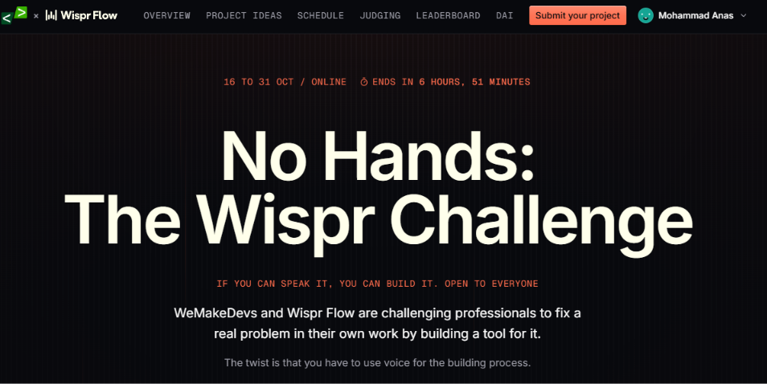

<p align="center">
  
</p>

<picture>
  <source media="(prefers-color-scheme: dark)" srcset="public/logo/new-logo.png">
  
</picture>

# Speech to Spec

**Speech to Spec** is a voice-to-build workspace that transforms stream-of-consciousness spoken requirements into rigorous, unambiguous technical specifications, BDD test suites, architecture diagrams, and coding agent prompts.

When software builders speak their feature requirements aloud, their speech is filled with self-corrections, implicit tradeoffs, unstated constraints, and conflicting requirements. Speech to Spec lints raw voice transcripts to extract verified quotes, surfaces tradeoffs, and converts them into deterministic specifications ready for autonomous coding agents (such as Antigravity, Cursor, and Claude Code).

---

## Features

- **Instant Rule-Based Hints**: Real-time client-side regex heuristics flag constraints (offline, no database, browser-only), identity-dependent features, automatic triggers, and revisions as you speak or type—before sending any tokens to AI.
- **Structured Requirements Linter**: Analyzes transcripts via Groq using strict JSON schema outputs (`strict: true`). Highlights verbatim quotes for self-corrections (where the last statement strictly wins) and categorized contradictions.
- **Interactive Conflict Map**: SVG circular dependency graph showing contradiction quotes as nodes and conflicts as severity-weighted edges.
- **Spec Readiness Gauge**: Heuristic metric starting at 100% and subtracting penalties for open contradictions and unresolved decisions. Dynamically recovers points as clarifying questions are answered or delegated.
- **12-Section Engineering Specification**: Exhaustive, production-grade markdown specification including Overview, Goals, Non-Goals, Data & Storage, Rules, Assumptions, Open Items, Decisions Log (stated/answered/assumed badges), and traceable Acceptance Checklist.
- **BDD Test Cases Generator**: AI QA engine producing up to 12 Given/When/Then scenarios directly mapped to acceptance checklist items.
- **Interactive Architecture Diagrams**: Browser-rendered Mermaid user flows and entity-relationship diagrams (ERDs) with client-side syntax validation.
- **AI Build Pack**: Ready-to-paste prompts formatted specifically for Antigravity, Cursor, and Claude Code, with direct downloads for `AGENTS.md`, `CLAUDE.md`, and GitHub issue templates.
- **History & Zero-Database Sharing**: Saves up to 10 completed sessions to local browser storage, and enables instantaneous, link-based sharing via URL hash compression (`lz-string`) with no database required.
- **Tab-Isolated BYOK & Settings**: Optional user-provided Groq API key kept strictly in memory for the current tab, configurable reasoning efforts (`low`, `medium`, `high`) across operations, and read-only model ID display.
- **Empirical Proof Benchmark**: Dedicated `/proof` comparison page evaluating build outcomes from raw speech versus Speech to Spec specifications.

---

## Quick Setup

```bash
git clone https://github.com/your-username/speech-to-spec.git
cd speech-to-spec
npm install
cp .env.example .env.local
npm run dev
```

Open [http://localhost:3000](http://localhost:3000) to start linting voice requirements.

---

## Environment Variables

| Variable | Required | Description |
|---|---|---|
| `GROQ_API_KEY` | Optional / Recommended | Groq Cloud API key used for live model inference (`openai/gpt-oss-120b`). If not set on the server, users can supply their own key directly in the browser Settings drawer for their tab session. |

---

## Groq Free Plan Limits & Live Calls

Speech to Spec is optimized for high-throughput reasoning models on Groq:

- **TPM & RPM Limits**: Groq's free tier imposes strict tokens-per-minute (TPM) and requests-per-minute (RPM) limits. 
- **Reasoning Effort Impact**: By default, Linting and Spec Generation use **High** reasoning effort to thoroughly untangle subtle speech contradictions, which generates detailed reasoning traces that consume token budget faster. You can switch to **Low** or **Medium** in the Settings drawer to conserve tokens.
- **Rate Limit Handling**: If a `429 Rate Limit` is encountered, the app displays the exact `retry-after` countdown without hammering the endpoint. Network timeouts and transient 500/503 errors are handled with exponential backoff and jitter.

---

## Cached Voice Samples

For offline development and rapid testing without consuming any Groq API tokens:
- When a submitted transcript matches `data/sample-transcript.txt`, the application serves the pre-cached analysis in `data/sample-lint.json` with `200 OK (cached)`.
- You can preview the generated specification offline anytime by visiting `/preview` (`data/sample/spec.md`).

---

## Real Case Studies (`data/cases/`)

The `/proof` page displays empirical case studies loaded directly from server session exports in `data/cases/`.

### How to Add a Case Study

1. **Run a session in the app**: Lint your spoken transcript, answer or delegate clarifying questions, and generate your engineering specification.
2. **Download session export**: In the **AI Build Pack** section at the bottom of the Spec view, click **"Download session JSON"**.
3. **Save to `data/cases/`**: Place the exported `.json` file inside `data/cases/` using a descriptive kebab-case filename (e.g., `data/cases/hostel-expense-splitter.json` or `data/cases/ecommerce-checkout.json`).
4. **Automatic loading**: The server automatically validates the exported session schema, generates a tab label from the filename, computes transcript metrics, and exposes the **Said**, **Found**, **Decided**, and **Spot-It-First** verification views on `/proof`. If no valid cases exist, the `/proof` route returns a 404 page and hides the link from navigation.

---

## Privacy & Security Note

- **Zero Logging Policy**: Raw speech transcripts, generated specifications, and API keys are **never** logged to stdout, files, analytics services, or error tracking.
- **Local Data Storage**: All session history, answers, and cached specifications remain inside your browser's `localStorage`.
- **BYOK Tab Isolation**: Any Groq API key entered in the Settings drawer is held purely in volatile React state in that browser tab. It is never saved to `localStorage`, `sessionStorage`, cookies, or the URL. It is transmitted only in an `x-groq-api-key` header for that request, is used only for that execution, and is never stored or echoed back.

---

## Architecture Overview

```
speech-to-spec/
├── app/
│   ├── api/
│   │   ├── diagrams/route.ts  # POST /api/diagrams (Mermaid flow & ERD)
│   │   ├── lint/route.ts      # POST /api/lint (requirements linter)
│   │   ├── sample/route.ts    # GET /api/sample (sample transcript)
│   │   ├── spec/route.ts      # POST /api/spec (spec generator)
│   │   └── tests/route.ts     # POST /api/tests (BDD test cases)
│   ├── about/page.tsx         # /about documentation & architecture page
│   ├── proof/page.tsx         # /proof empirical benchmark comparisons
│   ├── preview/page.tsx       # /preview offline sample spec viewer
│   ├── layout.tsx             # Root layout with SettingsProvider
│   └── page.tsx               # Main voice-to-build workspace (Input, Findings, Spec)
├── components/
│   ├── AppHeader.tsx          # Shared navigation header (Workspace, Proof, About)
│   ├── SettingsDrawer.tsx     # Settings drawer (BYOK key, reasoning effort, model ID)
│   ├── SettingsContext.tsx    # Tab-memory state context
│   ├── SpecViewer.tsx         # Markdown spec renderer, checklist, TOC, diff viewer
│   ├── BuildPack.tsx          # Agent prompt pack (Antigravity, Cursor, Claude Code)
│   ├── ReadinessMeter.tsx     # Dynamic spec-readiness heuristic gauge
│   ├── ConflictMap.tsx        # Pure React SVG circular contradiction graph
│   └── TranscriptHighlighter.tsx # Synced quote highlighter with normalized offsets
└── lib/
    ├── llm.ts                 # Groq client, structured output schemas, transient retries
    ├── spec.ts                # Spec generator system prompts and formatting
    ├── test-cases.ts          # BDD test cases generator with dynamic token budgets
    ├── diagrams.ts            # Mermaid diagrams generator and grammar sanitizers
    ├── validate.ts            # Normalized substring locator for speech transcripts
    └── session-storage.ts     # LocalStorage session manager & LZ-string URL encoder
```

---

## License

This project is open source and available under the [MIT License](LICENSE).
